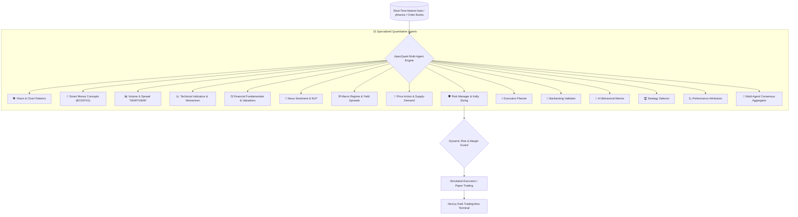

# ⚡ ApexQuant AI Platform
### Institutional-Grade Multi-Agent AI Trading Research, Risk Governance & Execution Engine

[](https://vikas2006256.github.io/Apexquant-AI-Platform/)
[](https://nextjs.org/)
[](https://fastapi.tiangolo.com/)
[](https://www.typescriptlang.org/)
[](https://python.org)
[](https://www.docker.com/)
[](https://tailwindcss.com/)
[](https://opensource.org/licenses/MIT)

---

## 🌐 Live Interactive Terminal

> **Access the Live Web Interface**:  
> 👉 **[https://vikas2006256.github.io/Apexquant-AI-Platform/](https://vikas2006256.github.io/Apexquant-AI-Platform/)**  
> Experience real-time TradingView charts, 15 AI agent telemetry consensus, Kelly criterion risk sizing, and backtesting sandboxes.

---

## 🏛️ Executive Overview

**ApexQuant AI** is an institutional quantitative trading terminal and decision-support infrastructure. It coordinates a deterministic consensus network of **15 specialized AI agents** that simultaneously audit real-time market microstructure, technical order flows, macroeconomic regimes, and financial fundamentals before approving trade executions.



---

## 🚀 Key Platform Capabilities

### 1. 15-Agent Consensus Network
* **Vision & Pattern Recognition**: Detects classic formations (head & shoulders, double bottoms, ascending triangles).
* **Smart Money Concepts (SMC)**: Pinpoints Break of Structure (BOS), Change of Character (CHOCH), and Fair Value Gaps (FVG).
* **Macro & Yield Regime**: Evaluates inflation prints, Fed funds trajectories, Treasury curves, and Dollar index (DXY).
* **Dynamic Kelly Sizing**: Mathematically adjusts risk allocations based on empirical win rates and payout ratios.

### 2. High-Performance Trading Terminal
* **TradingView Lightweight Charts v4**: Canvas-accelerated candlestick rendering with dynamic indicators and timeframes.
* **Institutional Dark UI**: Custom glassmorphism aesthetic built with Tailwind CSS, Framer Motion, and Outfit typography.
* **Real-Time Strategy Sandbox**: Dynamic parameter backtester evaluating CAGR, Maximum Drawdown, and Sharpe Ratio.

---

## 📁 System Architecture

```
.
├── .github/workflows/deploy.yml # Automated GitHub Pages CI/CD Pipeline
├── backend/                     # High-throughput FastAPI Engine
│   ├── app/
│   │   ├── api/v1/              # Market, Auth, Portfolio, Backtest & Agent Endpoints
│   │   ├── core/                # DB Config, Redis, JWT Security Utilities
│   │   ├── models/              # SQLAlchemy Database ORM Models
│   │   ├── schemas/             # Pydantic Request/Response Validation
│   │   ├── services/            # Market data streams, backtesting, paper trader
│   │   └── agents/              # 15 AI Quant Agents & Consensus Engine
│   ├── Dockerfile
│   └── requirements.txt
├── frontend/                    # Next.js 14 Web Application
│   ├── src/
│   │   ├── app/                 # Terminal Dashboard & /backtest Sandbox
│   │   ├── components/          # TradingView Chart & Multi-Agent Console
│   │   └── store/               # Zustand Global State Management
│   ├── Dockerfile
│   ├── package.json
│   ├── tailwind.config.ts
│   └── next.config.mjs
├── docker-compose.yml           # Multi-service container orchestration
├── init.sql                     # PostgreSQL schema & initial seed data
└── README.md
```

---

## 🛠️ Quickstart & Local Setup

### Option 1: Docker (Recommended)

```bash
# Clone the repository
git clone https://github.com/Vikas2006256/Apexquant-AI-Platform.git
cd Apexquant-AI-Platform

# Start all microservices (Postgres, Redis, FastAPI, Next.js)
docker-compose up --build
```
* **Frontend Terminal**: [http://localhost:3000](http://localhost:3000)
* **API Documentation**: [http://localhost:8000/docs](http://localhost:8000/docs)

### Option 2: Run Frontend Locally

```bash
cd frontend
npm install
npm run dev
```
Open [http://localhost:3000](http://localhost:3000) in your browser.

---

## 🔐 Security & Governance

- **JWT Authentication**: OAuth2 Password Flow with salted bcrypt password hashing.
- **Strict Risk Controls**: Pre-trade sanity checks preventing orders exceeding individual max portfolio loss limits.
- **Deterministic AI Logging**: Full audit trail of each agent's votes and confidence scores stored in PostgreSQL.

---

## ⚖️ Disclaimer

ApexQuant AI is designed for research, simulation, and decision-support purposes. All simulated trades reflect paper trading accounts. Past algorithmic performance does not guarantee future financial market returns. Always manage risk responsibly.
